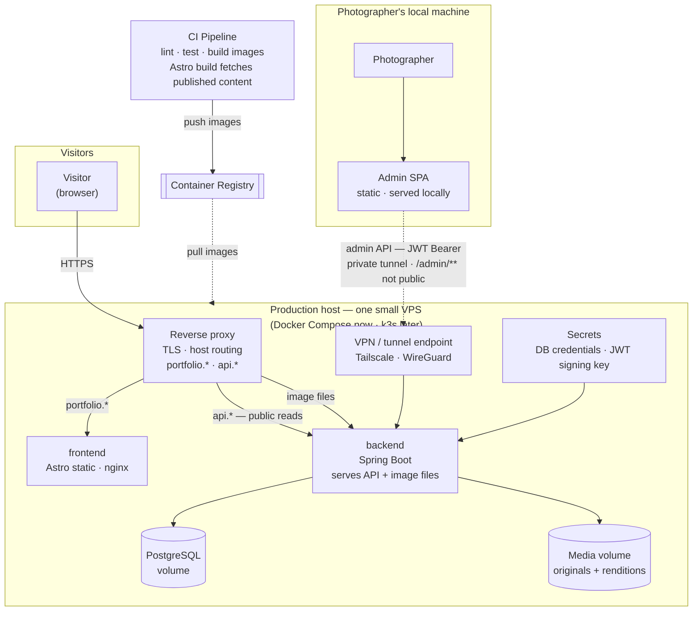
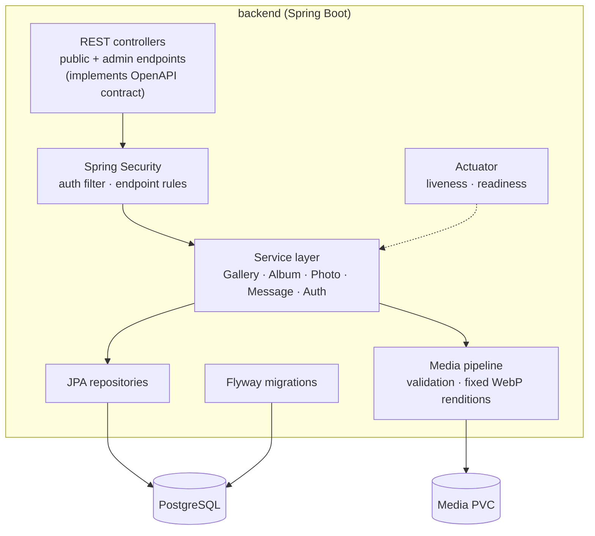
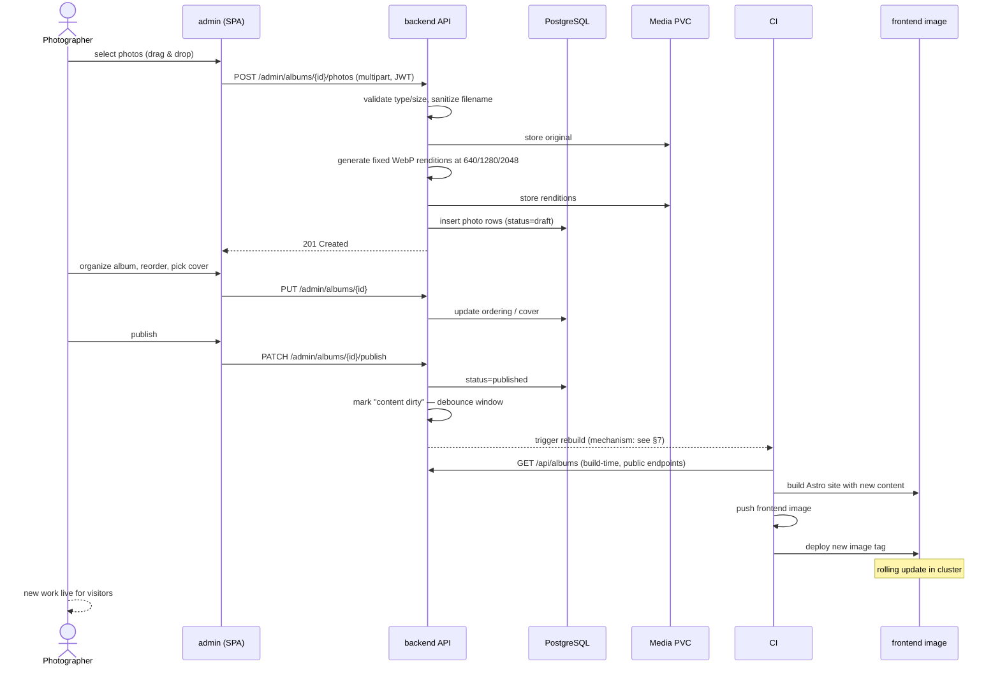
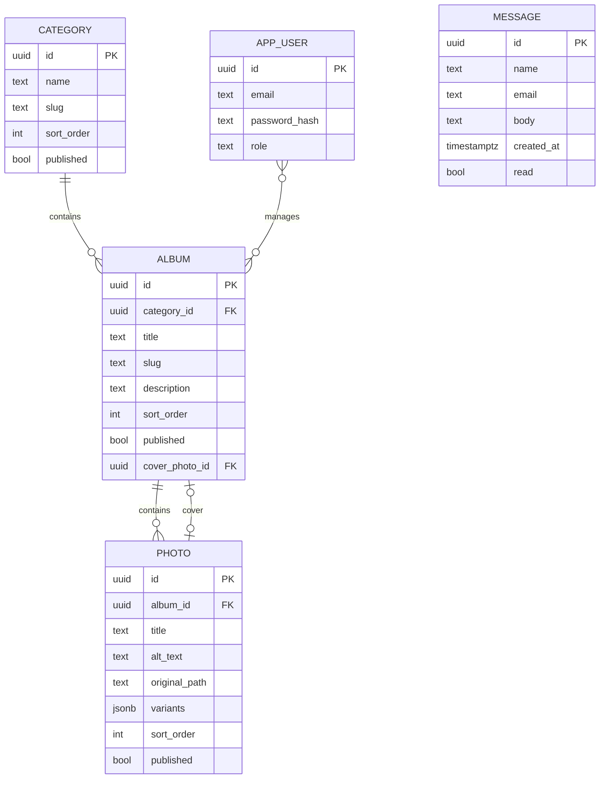
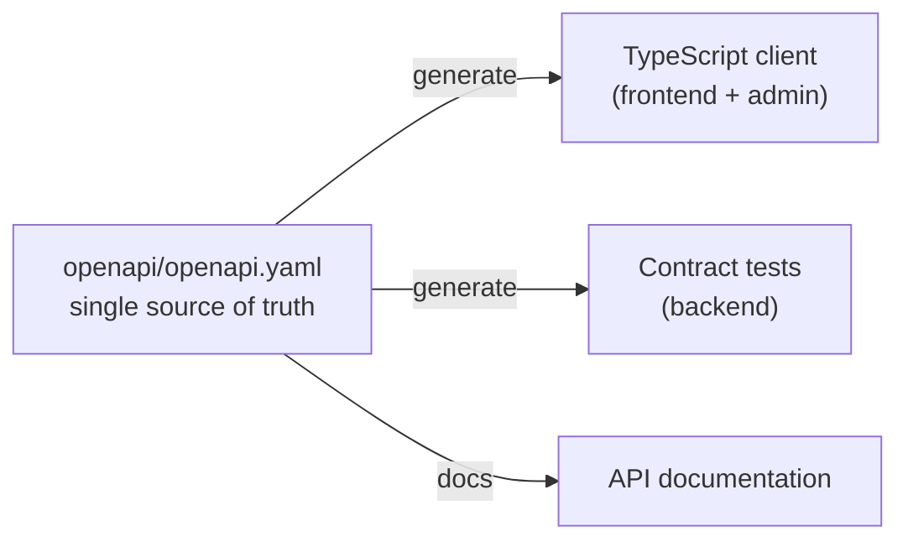

# Architecture — Portrait Photographer Portfolio

Review artifact. Three independently deployable modules (backend, public frontend, admin) shipped as separate Docker images. Two deployment targets: a **single small VPS** (Docker Compose now, k3s later) and a **local machine** for the admin app. Plus PostgreSQL and a media volume.

---

## 1. Deployment / runtime view

**Reading it:**

| Path | Runtime flow |
|---|---|
| Visitor → frontend | HTML/CSS/JS from the prebuilt Astro image (static) |
| Visitor → backend | Image files only, referenced by `` srcset from the media volume |
| Photographer → admin | Admin SPA runs **on the photographer's own machine** — never publicly exposed |
| Photographer → backend | Admin REST calls (login, upload, CRUD) travel over a **private tunnel**; `/admin/**` is not reachable from the internet |
| CI → registry → host | Each module's image is built, pushed, and pulled independently |

Note there are **no runtime API calls from the public frontend** — content is baked in at build time. That's the key trade-off: faster/cheaper serving, but a content change requires a frontend rebuild.

### Deployment topologies

| Topology | Where | Notes |
|---|---|---|
| **Local dev** | Developer machine | Root `docker-compose.yml` brings up all three modules + PostgreSQL. Every module also runs standalone from its own Dockerfile. |
| **Budget production** | One small VPS (€6–9/mo) + local admin | Docker Compose first; k3s later with the same images and manifests. |
| **Growth** | Multi-node k3s | Only when needed; media moves to object storage (R2/S3) to drop the single-attach constraint. |

On a single host, the RWO caveat disappears — one node attaches the volume fine. That's why the budget path can keep media on local disk and still serve it from the backend.

---

## 2. Backend component view

---

## 3. Key flow — upload → publish → visitor sees it

---

## 4. Domain model (first cut)

---

## 5. Contract boundary

The spec is what keeps three independently built (and AI-generated) modules from drifting apart.

---

## 6. Decisions (resolved)

| Decision | Choice | Consequence |
|---|---|---|
| Auth | **JWT** (Bearer token in `Authorization` header), stateless Spring Security | Works cleanly cross-origin — no cookie/`SameSite` problems. Token storage on the admin side needs care (below). |
| Image serving | **Backend serves the files** | Simple. Image traffic flows through the backend pods, so set `Cache-Control: immutable` on content-hashed renditions plus `ETag`, and size the pod's network/CPU for it. |
| Media volume | **RWO** | ReadWriteOnce attaches to a single node at a time → constrains replica count (below). |
| Admin location | **Photographer's local machine** | Not publicly exposed at all. Admin reaches the API over a private tunnel; CORS allowlists the local origin. |

### Consequence: admin on a local machine

The admin app is not a publicly hosted service — it runs on the photographer's own machine. That is a *security win* (no public admin surface, no admin credentials over the open internet) with a few consequences:

- **Network path**: the local admin needs to reach the backend. Preferred: a private tunnel — **Tailscale or WireGuard** (free for personal use). The API's `/admin/**` paths then never need to be public.
- **Split the API**: serve `/api/**` publicly (read-only, for the static build and image URLs) and keep `/admin/**` reachable only over the tunnel. Clean, and it means a 500 in the public API can't touch admin operations.
- **CORS**: allowlist the local origin(s) (`http://localhost:*`, the LAN name, or the tunnel hostname — pick exact origins, no wildcards).
- **Uploads over home bandwidth**: batch uploads go from the local machine to the VPS. Fine for a hobbyist; upload in sensible batches, and let the backend do the resizing.
- **Why JWT helps here**: no cookies means no `SameSite`/domain juggling between a local origin and a public API — the token travels in the `Authorization` header and just works.
- **Simpler fallback**: if a tunnel is too much, run the admin *inside* the VPS network over SSH port-forwarding (`ssh -L`) — zero extra services.

### Consequence: RWO + replica count

An RWO volume attaches to **one node**. A multi-replica backend Deployment can place pods on different nodes, and the extra pods will fail to mount the volume.

On the budget path this is a non-issue — there is only *one* host, so RWO (or a plain Compose volume) is exactly right. It only matters if the app ever grows to multiple nodes:

1. **Pin to a single backend replica** — simplest, no HA (fine here). ← current
2. Force all pods onto one node (pod affinity) — blocks clean rolling updates, not recommended.
3. Move to an RWX storage class (Longhorn, NFS, CephFS) — enables HA, adds ops.
4. Move media to object storage (R2/S3) — backend becomes stateless and horizontally scalable. Growth path.

### Consequence: CORS + media serving

- Backend configures CORS for the **admin origin only**, allowing `Authorization` and multipart uploads.
- Admin sends the JWT in the `Authorization` header (not a cookie) — exactly why JWT was the right call here.
- Token storage tradeoff: `localStorage` is simplest but XSS-exposed; **in-memory token + short expiry + refresh** is the better middle ground for an admin app.
- Images served by the backend should carry `Cache-Control: immutable` on content-hashed renditions plus `ETag`, since every image byte flows through the backend process.

## 7. Content-change trigger (open — options)

The public site is static, so published changes only appear after a **frontend rebuild**. Publishing therefore needs to kick off: *build image → push → roll out new tag*.

| Option | How it works | Pros | Cons |
|---|---|---|---|
| **A. Manual "Rebuild site" button** (in admin) + optional nightly cron | Button calls the CI trigger API; cron as a safety net | Trivial to build, no secrets in backend, no storms | Staleness if forgotten; not automatic |
| **B. Backend → CI webhook** (auto on publish) | On publish, backend POSTs to the CI provider (GitHub `repository_dispatch`, GitLab trigger token) | Fully automatic, uses existing CI | CI trigger token must be stored on the host; needs debounce; couples backend to CI provider |
| **C. B + debounce queue** | As B, but the "content dirty" event coalesces (e.g. 2–5 min) before firing once | Automatic *and* avoids rebuild storms during a big upload session | Slightly more code (small scheduler/queue) |
| **D. GitOps (Argo CD / Flux)** | CI still builds the image; a GitOps controller notices the new tag and syncs | Clean deploy story, drift detection, rollbacks | Doesn't trigger the *build* itself — still need A/B/C for that; only relevant once on k3s |
| **E. Drop static — frontend becomes SSR** | Node adapter; pages render per request, no rebuild ever | Instant publish, no pipeline at all | A permanent runtime pod, more attack surface, loses "static" simplicity; contradicts earlier choice |
| **F. Runtime client-side fetch** | Browser fetches content from the API | No rebuild | Kills build-time SEO and first paint — bad for a portfolio; rejected |

**Recommended path:** start with **A** (manual button + nightly cron) to get publish working with zero CI plumbing, then graduate to **C** (auto + debounce) once the flow is proven. Add **D** only if the cluster already runs a GitOps controller.

Mechanically, the CI job needs: the public API base URL (read-only, no auth), and — for the deploy step — a way to roll the frontend onto the host (Compose: pull new tag + `up -d`; k3s: `kubectl rollout` or GitOps taking over that step).
