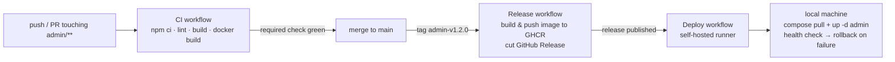
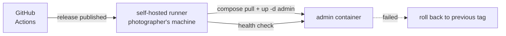

# CI/CD

How this repository builds, tests, publishes and deploys itself.

The **admin** module gets the first pipeline (ROADMAP.md Phase 6, then Phase 7) as a
deliberate learning exercise. It is the odd one out: it is **never deployed to a server** —
it runs on the photographer's own machine — which makes it a good place to learn the
mechanics on a target where a mistake costs nothing.

Backend and frontend reuse the same shape later (ROADMAP.md Phase 9 step 35, Phase 10).

Provider: **GitHub Actions** (`github.com:toledobrendo/btagila-portfolio`).
Registry: **GHCR**, the GitHub Container Registry.

---

## 1. Three things people call "CI/CD"

| Concept | Trigger | Produces | Who ships |
|---|---|---|---|
| **Continuous integration** | every push / pull request | a pass/fail verdict on the commit, in a clean environment | nobody — it just gates the merge |
| **Continuous delivery** | a version tag | a *releasable* artifact (a versioned image in a registry) | a human, with one explicit command |
| **Continuous deployment** | the artifact being published | a running service | a machine, automatically |

The distinction that matters: **delivery** ends with an artifact you *could* ship;
**deployment** actually ships it. Phase 6 is delivery. Phase 7 is deployment.

---

## 2. Pipeline at a glance



| Stage | Workflow file | Trigger | Output |
|---|---|---|---|
| CI | `.github/workflows/admin-ci.yml` | push/PR touching `admin/**` | green check + `admin-dist` artifact |
| Delivery | `.github/workflows/admin-release.yml` | tag `admin-v*` | image in GHCR + GitHub Release |
| Deployment | `.github/workflows/admin-deploy.yml` | release published | running admin container on the local machine |

---

## 3. Stage 1 — Continuous integration

Runs on a **GitHub-hosted** runner: a fresh Ubuntu VM, no state, thrown away afterwards.
That is the point — it proves the build works from the committed files alone, not from
whatever is lying around on your laptop.

What runs, and why each step earns its place:

| Step | Catches |
|---|---|
| `npm ci` | a `package-lock.json` that doesn't match `package.json`, or a dependency that can't install cold |
| `npm run lint` (oxlint) | dead code, suspicious patterns |
| `npm run build` (`tsc -b && vite build`) | type errors **and** an unbuildable app |
| `docker build` | a Dockerfile that silently rotted |
| upload `dist/` | lets you download and inspect the exact built output |

Notes:

- **Path filters** keep it cheap: only runs when `admin/**` (or the workflow itself)
  changes, so backend commits don't spend minutes here.
- **Caching**: `actions/setup-node` with `cache: npm` skips re-downloading the registry on
  every run. `docker/build-push-action` with `cache-from/to: type=gha` does the same for
  image layers.
- Run the same commands locally before pushing (see §9) — CI is the backstop, not the
  first time you find out.

<details>
<summary>Sketch — <code>.github/workflows/admin-ci.yml</code></summary>

```yaml
name: admin CI

on:
  push:
    branches: [main]
    paths: ['admin/**', '.github/workflows/admin-ci.yml']
  pull_request:
    paths: ['admin/**', '.github/workflows/admin-ci.yml']

permissions:
  contents: read

jobs:
  build:
    runs-on: ubuntu-latest
    defaults:
      run:
        working-directory: admin
    steps:
      - uses: actions/checkout@v4
      - uses: actions/setup-node@v4
        with:
          node-version: 22
          cache: npm
          cache-dependency-path: admin/package-lock.json
      - run: npm ci
      - run: npm run lint
      - run: npm run build          # tsc -b && vite build
      - run: docker build -t admin:ci .
      - uses: actions/upload-artifact@v4
        with:
          name: admin-dist
          path: admin/dist
```

</details>

---

## 4. Stage 2 — Continuous delivery

A version tag turns a green commit into a **named, immutable artifact**.

- Tag format: `admin-v1.2.0` (per-module prefix, so backend and frontend tags never
  collide later).
- Image: `ghcr.io/toledobrendo/btagila-portfolio/admin`, published with three tags —
  `1.2.0` (immutable, what deploys reference), `sha-<short>` (traceability back to the
  commit) and `latest` (convenience; never deploy by it).
- A **GitHub Release** is cut with generated notes, so "what changed in this version" is
  answerable without reading git log.
- `GITHUB_TOKEN` is enough to push to GHCR — no long-lived registry secret to manage. The
  workflow needs `packages: write`.

"Deploying" this artifact is a deliberate one-liner on the local machine:

```bash
docker compose pull admin && docker compose up -d admin
```

That is the whole loop: **tag → build → publish → consume**. Everything else in CI/CD is
elaboration on it.

<details>
<summary>Sketch — <code>.github/workflows/admin-release.yml</code></summary>

```yaml
name: admin release

on:
  push:
    tags: ['admin-v*']

permissions:
  contents: write     # create the GitHub Release
  packages: write     # push to GHCR

jobs:
  publish:
    runs-on: ubuntu-latest
    steps:
      - uses: actions/checkout@v4
      - uses: docker/setup-buildx-action@v3
      - uses: docker/login-action@v3
        with:
          registry: ghcr.io
          username: ${{ github.actor }}
          password: ${{ secrets.GITHUB_TOKEN }}
      - uses: docker/metadata-action@v5
        id: meta
        with:
          images: ghcr.io/${{ github.repository }}/admin
          tags: |
            type=semver,pattern={{version}}
            type=sha,format=short
            type=raw,value=latest
      - uses: docker/build-push-action@v6
        with:
          context: admin
          push: true
          tags: ${{ steps.meta.outputs.tags }}
          labels: ${{ steps.meta.outputs.labels }}
          cache-from: type=gha
          cache-to: type=gha,mode=max
      - uses: softprops/action-gh-release@v2
        with:
          generate_release_notes: true
```

</details>

---

## 5. Stage 3 — Continuous deployment

Delivery publishes; deployment pulls. For that, a machine has to be *listening* for new
artifacts — and for admin, that machine is the photographer's own laptop.

That listener is a **self-hosted runner**: the same GitHub Actions runner software, but
installed by you, registered to this repository, and executing on your hardware instead of
GitHub's.



What the deploy workflow does:

1. Pull the image tag from the release.
2. `docker compose up -d admin` (the compose service pins its tag via an env var, so the
   workflow controls which version runs).
3. **Health check** — poll the container until it answers, with a timeout.
4. **Roll back automatically** if the health check fails: restore the previous tag and
   bring the old container back up. A deploy that can't be reversed isn't a deploy.

### Security model — read this part twice

A self-hosted runner runs workflows **on your machine**, with your filesystem, your Docker
socket and your SSH keys within reach.

- **Private repository only.** Never attach this runner to a public repo, and never allow
  fork pull requests to trigger workflows on it — that is arbitrary code execution by
  strangers on your hardware.
- Scope it to a **runner group** and restrict which workflows may use it.
- Treat the runner host as a privileged machine: it can control Docker, which is
  effectively root. Keep its secrets (e.g. registry credentials for private pulls, tunnel
  config) on the runner itself, never in the repository.
- The deploy workflow is triggered by `release: published`, not by pull requests, so
  unreviewed code never executes there.

<details>
<summary>Sketch — <code>.github/workflows/admin-deploy.yml</code></summary>

```yaml
name: admin deploy (local)

on:
  release:
    types: [published]
  workflow_dispatch:        # allow a manual re-deploy

permissions:
  contents: read
  packages: read

jobs:
  deploy:
    runs-on: [self-hosted, local-admin]
    environment: deploy
    steps:
      - uses: actions/checkout@v4
      - uses: docker/login-action@v3
        with:
          registry: ghcr.io
          username: ${{ github.actor }}
          password: ${{ secrets.GITHUB_TOKEN }}
      - name: Pull and restart
        env:
          ADMIN_IMAGE_TAG: ${{ github.event.release.tag_name }}
        run: |
          docker compose pull admin
          docker compose up -d admin
      - name: Health check
        run: |
          for i in $(seq 1 20); do
            curl -fsS http://localhost:8080/ >/dev/null && exit 0
            sleep 2
          done
          echo "health check failed after 40s" >&2
          exit 1
      - name: Roll back
        if: failure()
        run: ./deploy/admin-rollback.sh    # re-deploys the previously recorded tag
```

</details>

---

## 6. Repository settings checklist

Configuration, not code — easy to forget, and the pipeline is only as good as it:

- **Actions** enabled; default `GITHUB_TOKEN` permissions **read-only** (workflows opt in
  to more, as the release workflow does with `packages: write`).
- **Branch protection** on `main`: require the admin CI checks before merging. Without
  this, CI is advisory and gets ignored.
- **Environments**: a `deploy` environment for the deployment workflow (and, later, an
  optional approval gate — the same mechanism you'd use for a production deploy).
- **Dependabot / Renovate** (optional): keeps action versions and npm deps current, using
  CI as the safety net.

---

## 7. Versioning

- Semantic versioning per module: `admin-v1.2.0` → `1.2.0`, `sha-<short>`, `latest`.
- Deployments reference the **immutable** `1.2.0` tag, never `latest` — so "what is
  running?" always has an exact answer, and a rollback is just a different tag.
- A tag is a promise the artifact exists; the release workflow is what makes it true.

---

## 8. Secrets & permissions

| Need | Where it comes from |
|---|---|
| Push image to GHCR | `GITHUB_TOKEN` + `packages: write` — no stored secret |
| Cut a release | `GITHUB_TOKEN` + `contents: write` |
| Local deploy target (compose env, tunnel config) | on the self-hosted runner, never in the repo |
| Future VPS deploy (Phase 10) | a `deploy` environment with its own secrets |

Rule of thumb: prefer the short-lived, auto-rotated `GITHUB_TOKEN` over a personal access
token; add a stored secret only when nothing else can do the job.

---

## 9. Local equivalents

Run these before pushing so CI rarely surprises you:

```bash
cd admin
npm ci
npm run lint
npm run build        # tsc -b && vite build
docker build -t admin:local .
```

(On this machine, until Node 22 is installed, the Docker-based commands in
`admin/README.md` do the same thing.)

---

## 10. Rollback

| Level | How |
|---|---|
| A bad *release* | `git revert`, tag again — the old image tag is still in GHCR |
| A bad *deployment* | automatic on failed health check; otherwise re-run the deploy workflow with the previous tag |
| A bad *image* | redeploy the previous `1.2.0` tag — immutable tags make this boring, which is the goal |

---

## 11. Deliberately deferred

Not needed for the PoC, listed so the omissions are on purpose:

- Backend/frontend pipelines — the Phase 6 admin workflow is the template (Phase 9 step 35
  promotes it to a reusable workflow).
- Deploying the public stack from CI to the VPS (Phase 10).
- Multi-architecture images (the local machine is x86-64; nothing needs `arm64` yet).
- SBOM/provenance and image signing (Cosign) — good practice, extra machinery.
- Preview deployments per pull request.
