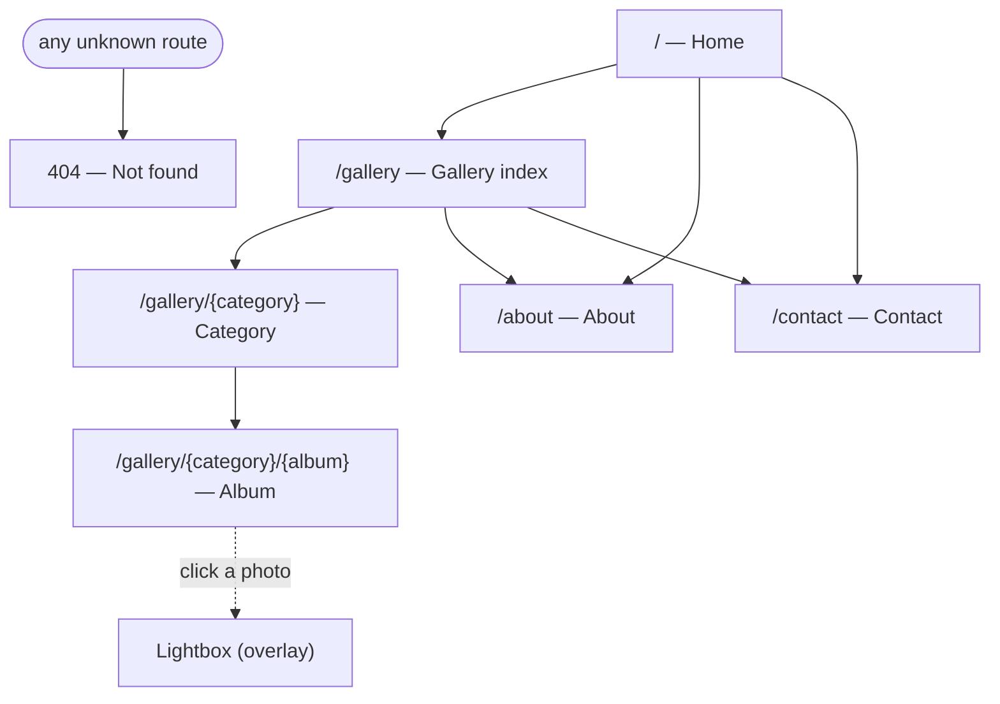
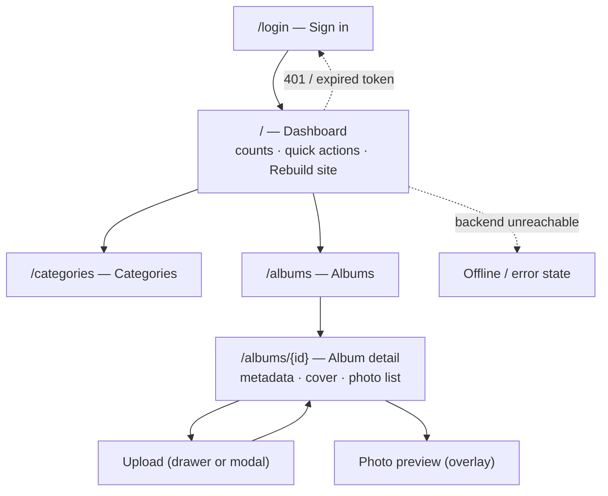

# Design brief — what to design, and at what size

The Figma brief for **ROADMAP.md Phase 2 step 7**. It lists every screen, the navigation
between them, the frame sizes to work in, and what to hand back so the design can be
transcribed into the real Tailwind theme. **Taxonomy:** albums use **tags** (many-to-many), not categories. An album must have ≥1 tag; filtering uses AND semantics for multiple tags; unpublished tags are hidden from public tag lists/pickers but do not affect album visibility. Tags have a **weight** (higher = higher priority), sortable by weight desc/name asc. Tags can be created inline from the album form. Keep routes under `/gallery` (use `?tag=`).

- **Behaviour** (states, flows, error cases) lives in `USE-CASES.md`.
- **Data** (what each screen can show) lives in `openapi/openapi.yaml`.
- **Where it's built** and which phase: `ROADMAP.md` (public site = Phase 8, admin = Phase 5).

You design in Figma; this file is the input and the handoff contract.

---

## 0. Before you open Figma

Three inputs make the difference between designing *something* and designing *this*:

1. **References** — 3–5 photographer portfolios you think look right, and ideally one you
   think looks wrong (and why). This is the taste source; everything else is craft.
2. **Real-ish content** — name/wordmark, tagline, a short bio, the real Facebook/Instagram
   handles, the email address.
3. **Real photos, mixed orientation** — several portrait **and** landscape images from an
   actual session. The grid only tells the truth with mixed aspect ratios (see §8.1).

---

## 1. Frame sizes

**Use Tailwind's default breakpoints as your frames.** That is deliberate: it makes each
frame map 1:1 onto a breakpoint utility (`md:`, `lg:`), so nothing has to be reinterpreted
when the design becomes code.

| Frame | Size (px) | Tailwind | Role |
|---|---|---|---|
| **Mobile** | 390 × 844 | base → `sm` (640) | primary — most visitors are on phones; must also work down to **320** |
| **Tablet** | 768 × 1024 | `md` (768) | check only; layout usually just gains columns |
| **Desktop** | 1440 × 900 | `lg`/`xl` | primary |
| **Wide check** | 1920 × 1080 | `2xl` (1536) | optional — verify the max-width container behaves |

Other rules:

- Design at **1× logical pixels**. Export raster assets at **2×**.
- **Heights are fluid.** Design *sections*, not fixed page heights — a page is as tall as its
  content. Don't tape a 844-tall artboard to a real page.
- **Container:** content max-width ≈ **1200–1280 px**, centred, with generous gutters —
  24 px desktop / 20 tablet / 16 mobile. Whitespace is a design decision here, not leftover space.
- **Responsive type:** state the size *per breakpoint* (e.g. an `h1` at 40/56/72 px) rather than
  one size that "scales".

### Admin is a different animal

The admin app runs on the photographer's **laptop only** — never publicly, never on a phone.

- Primary frame **1440 × 900**; verify it survives **1280 × 800**.
- **Do not design mobile admin.** It can be dense and utilitarian.
- Decide §8.6: does admin share the public design tokens, or is it plain/neutral? A shared set
  is less work; a separate set lets admin be compact.

---

## 2. Navigation map

### Public site (static Astro)

The **header** (wordmark + Work / About / Contact) is on every public page; the **footer**
carries the social links and the **build date**. Albums use **tags** (M:N); filtering is by
tag with **AND** semantics via `?tag=` (routes stay under `/gallery`). Unpublished tags are
hidden from public tag lists/pickers but do **not** affect album visibility. Tags use
**weight** (higher = higher priority), sorted by weight desc/name asc. Tags can be created
inline from the album form; a tag must be published/assignable to attach. An album must
have **≥1 tag**.

### Admin (SPA, desktop)

---

## 3. Screen inventory — public site

8 screens. `Serves` links each to its use case in `USE-CASES.md`.

| # | Route | Screen | Must include | Serves |
|---|---|---|---|---|
| 1 | `/` | **Home** | hero image, short intro, 1–3 featured albums, header, footer | UC-VIS-01 |
| 2 | `/gallery` | **Gallery index** | category cards (cover + name), header, footer | UC-VIS-02 |
| 3 | `/gallery/{category}` | **Category** | breadcrumb, album cards (cover + title), header, footer | UC-VIS-03 |
| 4 | `/gallery/{category}/{album}` | **Album** | breadcrumb, album title/description, **photo grid**, header, footer | UC-VIS-04, UC-VIS-09 |
| 5 | — | **Lightbox** (overlay on 4) | full image, prev/next, close, caption, keyboard affordances | UC-VIS-05 |
| 6 | `/about` | **About** | portrait, bio copy, optional CTA to Contact | UC-VIS-06 |
| 7 | `/contact` | **Contact** | Facebook + Instagram links, `mailto:` email. **No form.** | UC-VIS-07 |
| 8 | — | **404** | short message, link home / gallery | UC-VIS-08 |

**Global elements:** header (incl. the mobile menu, and its open/closed states) and footer
(© line, social icons, **build date** — the thing that proves a rebuild landed).

---

## 4. Screen inventory — admin

6 screens. Desktop only.

| # | Route | Screen | Must include | Serves |
|---|---|---|---|---|
| 1 | `/login` | **Sign in** | email + password, submit, inline error | UC-ADM-01 |
| 2 | `/` | **Dashboard** | counts (categories/albums/photos, drafts), quick actions, **"Rebuild site" button + last-built indicator** | UC-ADM-10, UC-ADM-11 |
| 3 | `/categories` | **Categories** | list with **drag handles** (order), published toggle, create/edit, delete with its "contains albums" refusal | UC-ADM-03 |
| 4 | `/albums` | **Albums** | list, filter by category, draft/published state, create | UC-ADM-04 |
| 5 | `/albums/{id}` | **Album detail** | metadata form (title, description, category, slug, published), **cover picker**, **photo list** with reorder + publish/draft + delete + **alt text**, upload entry point | UC-ADM-04, UC-ADM-06, UC-ADM-07, UC-ADM-08, UC-ADM-09 |
| 6 | — | **Upload** (drawer/modal from 5) | drag-and-drop dropzone, per-file progress, per-file validation errors, result | UC-ADM-05 |

**Global admin elements:** app shell (sidebar or topbar), current-user/sign-out, and the
**401 → re-authenticate** and **backend-unreachable** treatment (`UC-ADM-02`, `UC-ADM-12`).

---

## 5. States you must design — not just the happy path

The happy path is the easy 20%. These are the screens that decide whether the app feels
finished, and each already has criteria in `USE-CASES.md`:

| State | Where | Notes |
|---|---|---|
| **Empty** | Gallery index, Category, Album, admin lists | no categories / no albums / no photos — say what to do next |
| **Loading** | Admin lists, upload | skeletons or spinners |
| **Upload lifecycle** | Admin upload | idle → dragging → uploading → *one file invalid* → success; plus an **atomic failure** (nothing is imported) |
| **Draft vs published** | All admin content | visually unmistakable — this is the app's core risk (a draft leaking looks identical to a bug) |
| **Alt-text missing** | Album detail → publish | a photo with empty alt text **cannot be published**; design the block and how to fix it |
| **401 / expired session** | Any admin screen | sends back to login, quietly |
| **Backend unreachable** | Any admin screen | tunnel down — clear, non-destructive error |
| **409 refusals** | Categories (has albums), Albums (has photos) | explain *why*, offer the way out |
| **Long text** | Titles, descriptions | truncation vs wrap rules |
| **Reduced motion** | Lightbox, transitions | honour `prefers-reduced-motion` |
| **Mobile menu** | Public header | open and closed |

---

## 6. What to hand back (Figma → repo)

So the design becomes code without guesswork:

**Tokens** — as a labelled frame or an exported JSON:

- **Type** — font families, the full scale (size / weight / line-height / letter-spacing) per breakpoint.
- **Colour** — hex + a **role name** for each (`paper`, `ink`, `muted`, `accent`, `border`, …). Role names, not "grey-3" — they become the Tailwind `@theme` variables directly.
- **Spacing / rhythm** — the scale you actually used.
- **Radii, borders, shadows.**
- **Breakpoints / container width / gutters.**
- **Focus ring** — designed, not defaulted (see §7).
- **Motion** — durations + easings for the lightbox and any transitions.

**Components** — buttons (all states), header + mobile menu, footer, cards, the photo grid,
lightbox, form fields, admin table/list rows, upload dropzone, toasts/errors, badges for
draft/published.

**Assets** — wordmark/logo (**SVG**), favicon, an OG-image template.

**Figma structure suggestion:** one file, pages `Tokens` · `Components` · `Public` · `Admin`,
and **name each frame after its route** (`gallery/{category}/{album}`). That single habit makes
the handoff mechanical.

---

## 7. Accessibility (non-negotiable — it's in the acceptance criteria)

- **Contrast:** WCAG AA — 4.5:1 for body text, 3:1 for large text and UI borders.
- **Focus:** a designed, clearly visible focus ring on every interactive element (`UC-NFR-01`).
- **Targets:** ≥ 44 × 44 px touch targets on the public mobile frames.
- **Lightbox:** design the focus behaviour — it traps focus while open and returns it to the
  photo that opened it (`UC-VIS-05`).
- **Alt text is a first-class field**, not an afterthought — the design should make writing it
  quick (see §8.7).
- **Don't encode meaning in colour alone** — drafts need a label or icon, not just a tint.

---

## 8. Decisions to settle before you draw pixels

Each of these is cheaper to decide now than to retrofit. They're design calls, but they have
consequences I have to implement.

1. **Grid vs mixed aspect ratios** — the important one. Renditions are longest-side
   (640/1280/2048), so portrait `1365×2048` and landscape `2048×1365` coexist. Do you **crop
   to a uniform grid**, or use a **masonry / justified layout** that keeps native ratios?
   Either is fine; they feel completely different, and it changes the markup.
2. **Typography** — the single biggest signal of "expensive" vs "template".
3. **Palette** — almost certainly near-neutral, so the photos supply the colour.
4. **Lightbox treatment** — chrome, transitions, caption placement, mobile gesture behaviour.
5. **Mobile grid columns** — 1 or 2 per row on phones (affects perceived quality and scroll length).
6. **Admin tokens** — share the public set, or a separate neutral/utilitarian one?
7. **Alt-text UX** — every uploaded photo needs it before it can be published, so a 50-photo
   batch means 50 descriptions. Design a fast path: inline editing, a bulk pass, or a
   "publish blocked" queue. This is the most likely place for the app to feel tedious.
8. **Pagination UI** — album photo lists are paginated (`page`/`size`); decide infinite scroll,
   "load more", or paged controls.

---

## 9. Out of scope for the design

- No contact form — Contact is static links (`openapi/README.md`).
- No search, no tags, no multi-user, no i18n.
- No mobile admin.
- No on-site editing UI — content is authored in admin, served statically.

---

## 10. Rough effort

≈ **14 screens** (8 public + 6 admin) plus ~**10 state variants** and the token/component
frames ≈ **15–20 artboards**. The public album + lightbox is the one to nail first — it's the
most image-heavy, the most visited, and the vertical slice that validates the tokens.
